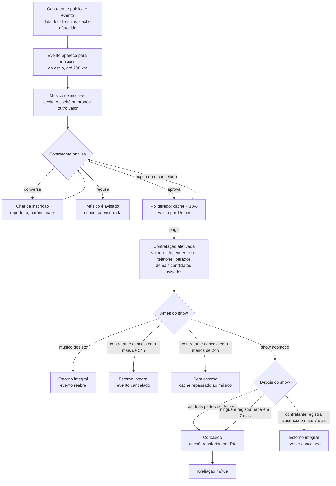
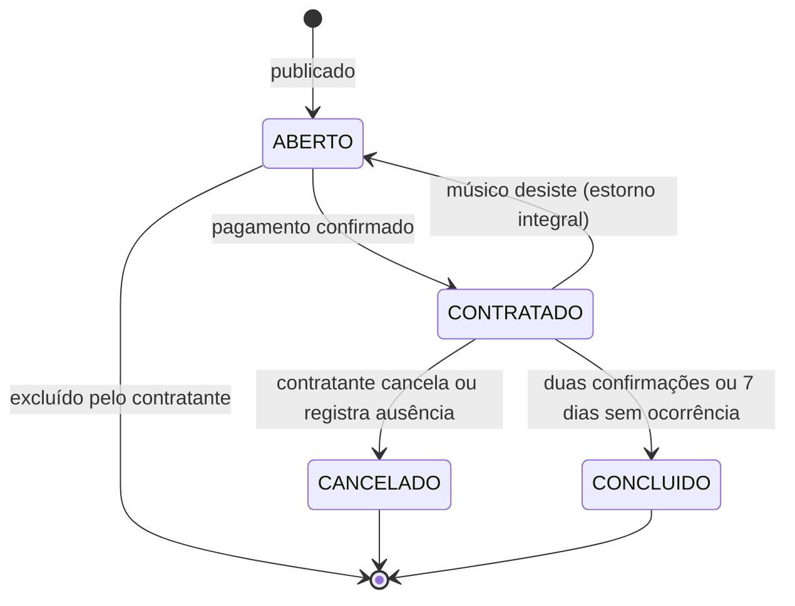
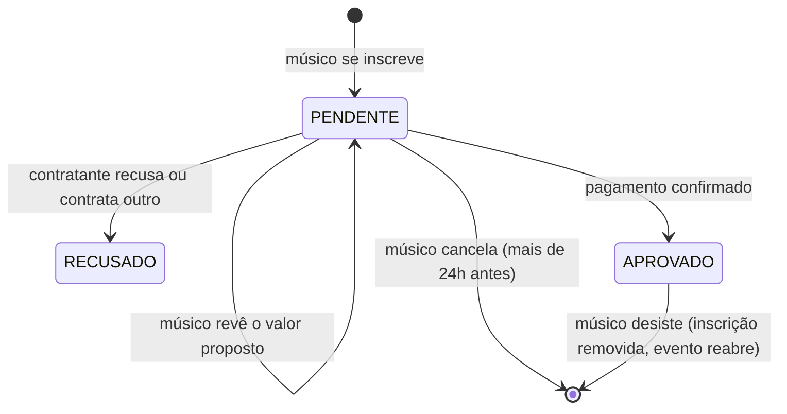
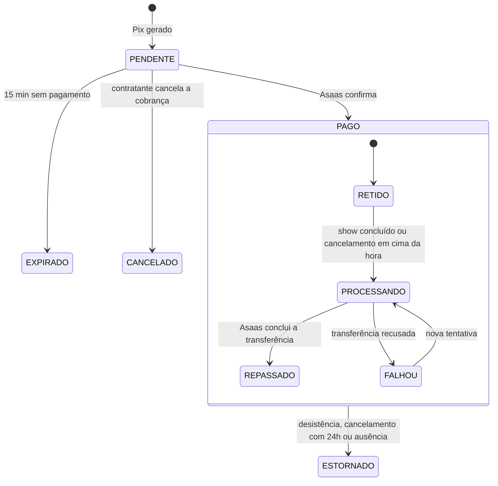
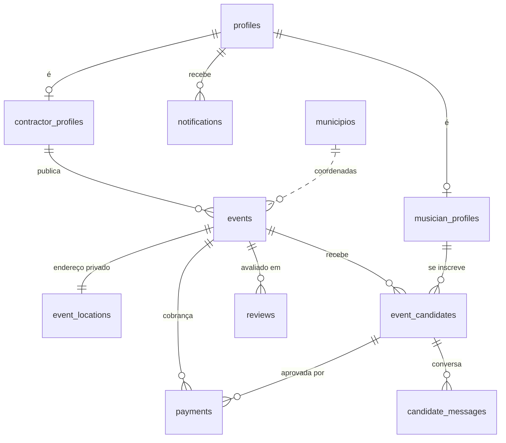

# Muve: proposta, regras e o que o documento não dizia

Este documento explica o produto de ponta a ponta: o problema, como o app resolve, as regras completas e as decisões que a monografia (`Projeto Acadêmico - Aplicativo Muve`) deixou em aberto. As decisões técnicas estão em [arquitetura.md](arquitetura.md).

## 1. A proposta

**Problema (monografia, 1.1):** contratar músicos independentes é informal. O músico corre o risco de levar calote ou receber com atraso; o contratante corre o risco de o músico faltar ou cancelar em cima da hora. Ninguém tem garantia nem histórico confiável da outra parte.

**Resposta da Muve:** um intermediário que segura o dinheiro até o show acontecer e registra a reputação dos dois lados.

| Dor | Como a Muve resolve |
|---|---|
| Músico leva calote | O contratante paga antes, por Pix. O valor fica retido e só sai para o músico depois do show. |
| Músico falta | O contratante registra a ausência e recebe tudo de volta. |
| Contratante cancela em cima da hora | Com menos de 24h, não há devolução: o cachê vai para o músico. |
| Não se conhecem | Avaliações de 1 a 5 dos dois lados, só depois de um show concluído. |
| Achar o músico certo | O evento só aparece para músicos do estilo pedido, na cidade ou num raio de até 200 km. |
| Combinar detalhes | Conversa dentro do app e proposta de cachê na inscrição. |

## 2. A jornada

## 3. Estados

### Evento

Um evento ABERTO cuja data passou aparece como "Encerrado sem contratação" e pode ser excluído.

### Inscrição

### Dinheiro

O estorno tem um estado próprio enquanto a Asaas processa: nesse intervalo, confirmação e repasse ficam suspensos.

## 4. Regras

| Regra | Valor |
|---|---|
| Cachê mínimo | R$ 100,00 |
| Taxa da plataforma | 10%, somada ao cachê e paga pelo contratante; o músico recebe o cachê inteiro |
| Valor cobrado | Proposta do músico, se houver; senão, o cachê oferecido. Sempre lido do banco. |
| Revisão da proposta | Só com a inscrição pendente e sem cobrança em andamento |
| Validade do Pix | 15 minutos |
| Alcance do evento | Mesmos estilos (ou "Qualquer estilo"); mesma cidade ou até 200 km |
| Cancelar inscrição | Até 24h antes do evento |
| Encerrar inscrições | O contratante pode encerrar e reabrir antes da contratação; encerrado, o evento sai do feed, mas os inscritos continuam podendo ser aprovados |
| Horário do evento | Digitado e exibido no fuso do estado do evento (Acre, Amazonas, Rondônia, Roraima, Mato Grosso e Mato Grosso do Sul fora do horário de Brasília) |
| Cancelamento pelo contratante | Mais de 24h antes: estorno integral. Menos de 24h: sem estorno, cachê vai ao músico. |
| Desistência do músico contratado | Antes do início: estorno integral e o evento reabre |
| Não comparecimento | Depois do horário, até 7 dias, se ninguém confirmou o show: estorno integral |
| Conclusão | Duas confirmações, ou 7 dias após a data sem registro de ausência |
| Avaliação | 1 a 5 estrelas, uma por pessoa por evento, só depois de concluído |
| Conversa | Entre o músico e o dono do evento; fecha quando a inscrição é recusada ou o evento termina |
| Dados privados | CPF/CNPJ e chave Pix nunca aparecem a terceiros; endereço e telefone só depois da contratação |
| Exclusão de conta | Bloqueada com show contratado, cachê a repassar ou estorno em processamento; as avaliações que a pessoa deixou ficam, sem autoria |

## 5. Notificações

| Acontecimento | Quem recebe | Também por e-mail |
|---|---|---|
| Nova inscrição (com o valor proposto) | Contratante | não |
| Nova mensagem | A outra parte da conversa | não |
| Inscrição recusada | Músico | não |
| Pagamento confirmado | Músico contratado e contratante | sim |
| Outro músico foi escolhido | Demais inscritos | não |
| Evento alterado (data, local, estilos ou cachê) | Inscritos pendentes | não |
| A outra parte confirmou o show | Quem ainda não confirmou | sim |
| Desistência ou cancelamento | A outra parte | sim |
| Não comparecimento registrado | Músico | sim |
| Cachê repassado | Músico | sim |

E-mail só sai se houver SMTP configurado. No app, o sino da tela inicial mostra os avisos em tempo real.

## 6. Dados

| Tabela | Para quê |
|---|---|
| `profiles` | Tipo de conta de cada usuário do Supabase Auth |
| `musician_profiles` / `contractor_profiles` | Dados do perfil; documento, telefone e chave Pix só pela API |
| `events` / `event_locations` | Evento; o endereço fica separado e só o contratado lê |
| `event_candidates` | Inscrições, com status e valor proposto |
| `candidate_messages` | Conversa de cada inscrição |
| `payments` | Cobrança, valores, retenção, repasse e estorno |
| `asaas_webhook_events` | Avisos da Asaas já processados (evita duplicidade) |
| `reviews` | Avaliações mútuas |
| `notifications` | Avisos dentro do app |
| `municipios` | Coordenadas das 5.571 cidades, para a distância |

## 7. API

| Método e rota | O que faz |
|---|---|
| `POST /auth/signup` | Cadastro com aceite dos Termos |
| `GET /me`, `PATCH /me`, `DELETE /me` | Perfil, completar perfil, excluir conta |
| `POST /me/notificacoes/lidas` | Marca as notificações como lidas |
| `POST /events`, `PATCH /events/:id`, `DELETE /events/:id` | Publicar, editar e excluir evento |
| `POST /events/:id/candidatura` | Inscrever-se, com proposta opcional |
| `PATCH /events/:id/candidatura` | Rever a proposta |
| `DELETE /events/:id/candidatura` | Cancelar a inscrição |
| `POST /events/:id/candidatos/:candidateId/recusa` | Contratante recusa uma inscrição |
| `PATCH /events/:id/inscricoes` | Encerrar ou reabrir as inscrições |
| `POST /candidaturas/:id/mensagens` | Enviar mensagem na conversa |
| `POST /events/:id/checkout`, `GET`, `DELETE` | Gerar, consultar e cancelar o Pix |
| `GET /events/:id/contratacao` | Comprovante da contratação |
| `DELETE /events/:id/contratacao` | Cancelar ou desistir |
| `POST /events/:id/nao-comparecimento` | Registrar ausência do músico |
| `POST /events/:id/confirmacao` | Confirmar que o show aconteceu |
| `POST /events/:id/avaliacao` | Avaliar a outra parte |
| `POST /webhooks/asaas` | Avisos de pagamento, estorno e transferência |

Leituras (feed, eventos, inscrições, perfis públicos, mensagens, avaliações, notificações) vão direto ao banco, limitadas pela RLS.

## 8. O que a monografia não definia, e o que decidimos

| Ponto em aberto | Decisão |
|---|---|
| Quem procura quem? A monografia fala em criar eventos (RF03) e em filtros de busca do contratante (RF04). | O contratante publica o evento e os músicos compatíveis se inscrevem. Evita o contratante ter de garimpar perfis e dá ao músico uma lista de oportunidades. |
| Negociação do valor | O músico aceita o cachê ou propõe outro na inscrição, e pode rever enquanto espera. O valor cobrado é sempre o que está gravado. |
| Comunicação entre as partes | Conversa por inscrição dentro do app; telefone e WhatsApp só depois de contratado, para o pagamento não sair da plataforma. |
| "Repasse em D+7" e "após confirmação mútua" (4.2 e RN02) se contradizem | Duas confirmações liberam na hora; sem confirmação e sem reclamação, o show é dado como realizado em 7 dias. |
| O que acontece se ninguém confirma | Conclusão automática em 7 dias. O contratante tem esses 7 dias para registrar ausência. |
| Desistência do músico contratado | Estorno integral ao contratante e o evento volta a receber inscrições. |
| Validade da cobrança | 15 minutos; um Pix pago depois de expirado ou cancelado é estornado sozinho. |
| Candidatos não escolhidos | São avisados; o contratante também pode recusar inscrições uma a uma. |
| Evento alterado depois de receber inscrições | Permitido até a contratação; os inscritos são avisados de mudanças relevantes. |
| Evento que passou sem contratação | Fica como "encerrado sem contratação" e pode ser excluído. |
| Exclusão de conta (LGPD) | Permitida a qualquer momento, exceto com show contratado ou dinheiro ainda não repassado ou devolvido. |
| Termos de uso | Tela própria, aceite obrigatório no cadastro, versão e data gravadas. |
| Notificações (RNF04 só cita "processamento assíncrono") | Avisos no app em tempo real e e-mail opcional, com a lista da seção 5. |
| Raio de atuação do artista (RF02) | Em vez de um raio fixo no perfil, o músico escolhe no feed: minha cidade, 50, 100 ou 200 km. |

## 9. Monografia × implementação

| Item | Situação | Observação |
|---|---|---|
| RN01/RN02: taxa de 15% descontada do artista, split 85/15 | Adaptado | Taxa de 10% somada ao cachê, paga pelo contratante. A plataforma recebe e transfere por Pix (custódia própria). Em produção, o caminho regulado é o split com Conta Escrow da Asaas. |
| RN03: cancelamento sem penalidade só com 24h | Implementado | |
| RN04: cancelamento tardio retém 20% (10% artista, 10% plataforma) | Adaptado | Hoje o músico recebe o cachê inteiro. Mais simples de explicar e mais justo com quem reservou a data. |
| RN05: ausência gera estorno e multa de 20% no cartão do artista | Parcial | Estorno integral implementado. Sem multa: exigiria cartão do músico na inscrição (RF05), uma barreira grande para quem quer receber, não pagar. |
| RN06: data, horário e duração obrigatórios | Implementado | |
| RN07: busca prioriza Premium e nota alta | Não implementado | Sem plano Premium. O feed ordena por distância e depois por data. |
| RN08: Shadowban de 15 dias | Não implementado | Trabalho futuro. Hoje a reputação aparece nas avaliações. |
| RN09: informações estratégicas só para contratantes | Interpretado | Perfil completo do músico só para o dono do evento em que ele se inscreveu. |
| RN10/RF01: KYC de CPF/CNPJ na Receita | Parcial | Validação dos dígitos e um documento por conta; sem consulta à Receita. |
| RF04: filtro por público-alvo | Não implementado | |
| RF05: cartão tokenizado do artista | Não implementado | Ver RN05. |
| RF06/RF08: escrow e split no gateway | Adaptado | Retenção na conta da plataforma e transferência Pix (sandbox). |
| RF07: duplo OK | Implementado | Com conclusão automática em 7 dias. |
| RF09: multas automáticas | Parcial | Só a regra das 24h do contratante. |
| RF10: avaliação mútua | Implementado | |
| RNF01: PCI-DSS | Não se aplica | Só Pix; nenhum dado de cartão passa pelo sistema. |
| RNF02: Docker e Azure | Adaptado | API Node simples de hospedar (Render, Railway); banco no Supabase. |
| RNF03: log imutável | Parcial | Webhooks registrados e datas em cada tabela; sem trilha de auditoria completa. |
| RNF04: notificações e webhooks assíncronos | Implementado | |
| Protótipo: aba Contratos | Adaptado | O comprovante da contratação cumpre esse papel. |
| Mediação de disputas | Não implementado | Regras objetivas no lugar de mediação manual. |

## 10. O que ainda falta

1. **Push no celular.** As notificações aparecem com o app aberto. Avisos com o app fechado exigem Expo Notifications num app gerado pelo EAS; o Expo Go no Android não recebe push.
2. **Hospedagem da API e SMTP.** Passo a passo no README. Sem a API publicada, a Asaas não consegue avisar pagamentos e transferências (o app compensa consultando a Asaas); sem SMTP, a confirmação de cadastro e a recuperação de senha dependem do envio limitado do Supabase.
3. **Autorização de transferências na Asaas.** No sandbox, cada repasse espera aprovação manual no painel.
4. **Monografia.** Os itens "Adaptado" e "Não implementado" da seção 9 precisam ser reescritos ou listados como trabalhos futuros.
